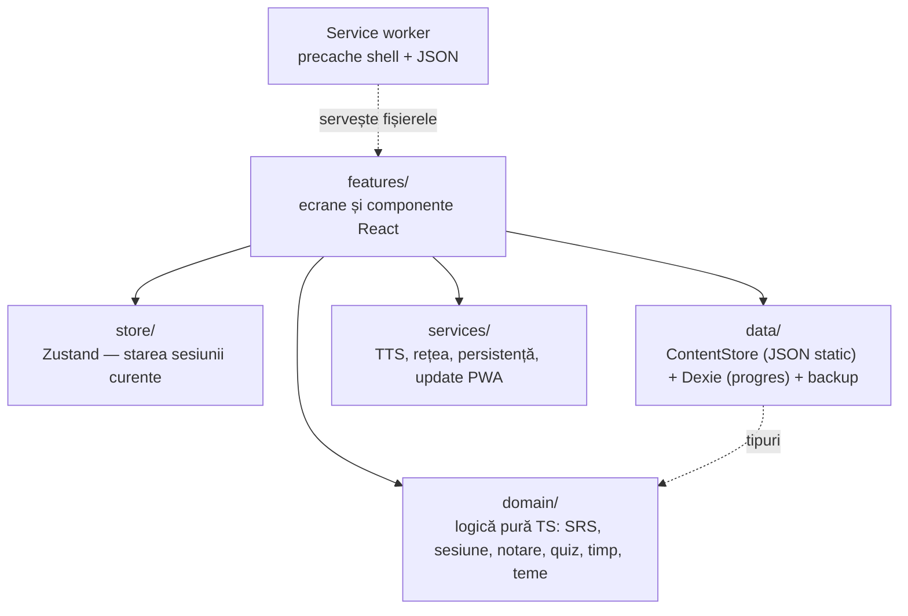
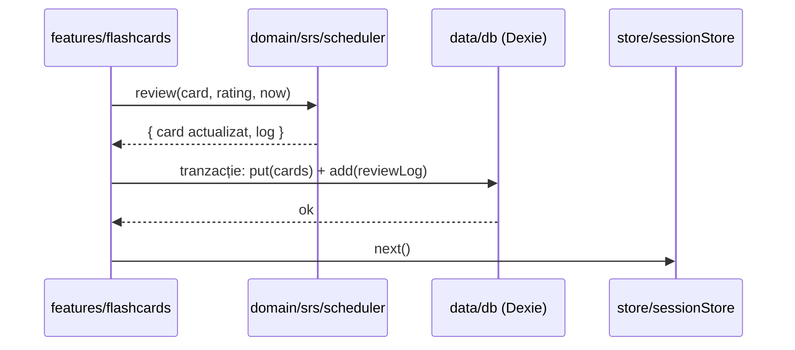

## Arhitectura aplicației „Impara l'Italiano”

Documentul descrie **cum** este organizată aplicația: straturile, structura de directoare, modelul de date și fluxurile principale. Cerințele, stack-ul și roadmap-ul se află în [app-plan.md](app-plan.md).

---

### 1. Vedere de ansamblu

Aplicația are trei părți:

```
[Build-time]  content/ ──► scripts/ (frecvență, conjugări, validare Zod) ──► src/data/generated/*.json
[Runtime]     React SPA (client-only) ──► domain/ (TS pur) ──► data/ (ContentStore + Dexie)
[Offline]     Service worker (Workbox) — precache: app shell + JSON-uri de conținut
```

* **Build-time:** conținutul (cuvinte, conjugări, propoziții, teme) este pregătit, validat și transformat în fișiere JSON înainte de build. Aplicația nu face cereri de rețea pentru date.
* **Runtime:** o aplicație React care rulează integral în browser, fără backend.
* **Offline:** service worker-ul pune în cache aplicația și conținutul; audio folosește vocile din sistem (funcționează și offline) și necesită internet doar dacă nu există o voce italiană locală (FR4).

#### Straturile runtime



**Reguli de dependență:**
* `features/` poate importa din `domain/`, `data/`, `services/`, `store/`, `ui/`.
* `domain/` **nu importă nimic** din celelalte straturi: fără React, fără Dexie, fără API-uri de browser. Primește timpul curent (`now`) ca parametru.
* `data/` importă doar tipuri din `domain/`.

---

### 2. Structura de directoare

```
content/                 sursa de adevăr pentru conținut (în git)
  words/                 tranșe: tranche-01-verbs.json, tranche-02.json ...
  verbs/irregular.json   forme neregulate scrise explicit
  sentences/             propoziții pentru Reconstruire
  topics/                teme: fișe ordonate de id-uri de cuvinte + reguli (Faza 4)
  grammar/               teme de gramatică pentru Jocuri: reguli + exemple cu lacună, în ordinea de învățare („order”)
  sources/               liste brute de frecvență (în .gitignore)
scripts/                 pipeline build-time (rulat direct cu Node 24, care elimină tipurile)
  frequency/             lematizare + scor combinat 70/30 (încă neimplementat)
  conjugate/             rules.ts (reguli -are/-ere/-ire/-isc), build.ts (combinare cu formele neregulate)
  content.ts             încarcă și validează conținutul (Zod + verificări încrucișate)
  validate-content.ts    `npm run validate`
  build-data.ts          `npm run build:data` — emite src/data/generated/*.json + meta.json (dataVersion)
  design/mascot.py       `npm run mascot` — Lupino: SVG-urile ipostazelor (din design/lupino/*.jpg) și iconițele PWA
src/
  app/                   App.tsx, router, layout cu bottom nav, providers
  i18n/                  textele interfeței: ro.ts (chei), it.ts (italiana, la cerere), useT(), plurale
  features/              flashcards, conjugation, quiz, sentence, browse, topics, games, stats, settings, about
  domain/                logică pură, acoperită integral de teste unitare
    content/             tipuri + scheme Zod (partajate cu scripts/)
    srs/                 scheduler.ts (wrapper ts-fsrs), mastery.ts, unlock.ts
    session/             buildDailySession.ts
    grading/             normalize.ts, compareAnswer.ts, gradeConjugation.ts, gradeSentence.ts
    quiz/                distractors.ts
    time/                studyDay.ts (granița 04:00), streak.ts
    topics/              numbers.ts, clock.ts, positions.ts, skills.ts, pairs.ts, order.ts (Faza 4)
  data/
    content/             contentStore.ts — încarcă JSON-urile, indexează după id / categorie / rang
    db/                  db.ts (schema Dexie + versiuni), repositories (cards, reviewLog, settings, reports, meta)
    backup/              export.ts, import.ts (validate cu Zod)
    generated/           JSON-uri emise de scripts/build-data.ts (nu se editează manual)
  services/              tts.ts, network.ts, storagePersist.ts, pwaUpdate.ts
  store/                 sessionStore.ts (Zustand — doar starea sesiunii curente)
  ui/                    componente comune (shadcn în ui/components), FlipCard, SwipeCard, Clock, PositionScene
tests/e2e/               Playwright
public/                  manifest, iconițe
```

**Corespondența cerințe → module:**

| Cerință | Module |
| --- | --- |
| FR1 Baza de date de cuvinte | `content/`, `scripts/`, `data/content`, `features/browse` |
| FR2 Module de învățare | `features/flashcards`, `features/quiz`, `features/sentence`, `features/conjugation`, `domain/grading`, `domain/quiz` |
| FR2.5 Teme | `content/topics`, `features/topics`, `domain/topics`, `ui/Clock`, `ui/PositionScene` |
| FR3 SRS (FSRS) | `domain/srs`, `domain/session`, `data/db` |
| FR4 Audio | `services/tts`, `services/network` |
| FR5 Progres și statistici | `features/stats`, `domain/time`, `data/db` (reviewLog) |
| FR6 Setări și date | `features/settings`, `data/backup` |

---

### 3. Modelul de date

#### 3.1 Conținut static (read-only, generat, inclus în build)

| Fișier | Conținut | Încărcare |
| --- | --- | --- |
| `words.json` | toate cuvintele (structura de mai jos) | la pornire |
| `conjugations.json` | formele conjugate, pe verb și timp | **lazy**, doar în modulul de conjugare |
| `sentences.json` | propozițiile pentru Reconstruire | **lazy**, doar în modulul de propoziții |
| `topics.json` | temele (§12) | **lazy**, doar în secțiunea Teme și pe pagina cuvântului |
| `meta.json` | `{ dataVersion, generatedAt, rankBasis, wordCount, sources[] }` — atribuirea pentru ecranul „Despre” | la pornire |

Fișierele sunt importate din cod (`import("../generated/words.json")`), deci Vite le include ca chunk-uri JS; service worker-ul le pune în cache împreună cu restul aplicației și nu există cereri de rețea separate. Fișierele din `src/data/generated/` sunt produse de `npm run build:data` și nu se păstrează în git.

Dimensiune estimată: ~400 KB necomprimat / ~100 KB gzip pentru 1000 de cuvinte, deci conținutul se ține integral în memorie.

**Structura unui cuvânt:**

```ts
type Pos = "verb" | "noun" | "adjective" | "adverb" | "pronoun"
         | "preposition" | "conjunction" | "numeral" | "interjection"
         | "expression";             // expresii din mai multe cuvinte (Faza 4)

interface BaseEntry {
  id: string;                 // stabil, ex. "n-casa", "v-parlare"
  it: string;
  ro: string;
  pos: Pos;
  tags: string[];             // tematice, ex. "expresii", "mâncare"
  rank: number;               // rang de frecvență combinat
  examples: { it: string; ro: string }[];
  falseFriend?: string;       // avertisment pentru vorbitori de română
  note?: string;
}

interface Noun extends BaseEntry {
  pos: "noun";
  gender: "m" | "f";
  article: "il" | "lo" | "la" | "l'";
  plural: string;
  pluralArticle: "i" | "gli" | "le";
  irregularPlural: boolean;
}

interface Adjective extends BaseEntry {
  pos: "adjective";
  forms: { ms: string; fs: string; mp: string; fp: string };
}

interface Verb extends BaseEntry {
  pos: "verb";
  group: "are" | "ere" | "ire" | "isc";
  auxiliary: "avere" | "essere" | "both";
  pastParticiple: string;
  irregular: boolean;
  reflexive: boolean;
}
```

**Conjugări:**

```ts
type Tense = "presente" | "passatoProssimo" | "imperfetto" | "futuro"
           | "condizionale" | "imperativo" | "congiuntivo";

// 6 persoane: io, tu, lui/lei, noi, voi, loro.
// Fiecare poziție conține una sau mai multe forme acceptate
// (ex. "sono andato" / "sono andata" la passato prossimo cu essere).
type Conjugations = Record<string /* verbId */, Partial<Record<Tense, string[][]>>>;
```

**Propoziții:**

```ts
interface Sentence {
  id: string;
  wordIds: string[];          // cuvintele din dicționar folosite
  it: string;
  ro: string;
  tokens: string[];           // blocurile afișate, fără punctuație
  acceptedOrders: number[][]; // ordinile corecte, ca indici în tokens
}
```

#### 3.2 Progres (Dexie / IndexedDB)

| Tabel | Cheie / indexuri | Conținut |
| --- | --- | --- |
| `cards` | `cardId`; `due`, `wordId`, `kind`, `state` | obiectul FSRS `Card` complet din `ts-fsrs` (inclusiv `learning_steps`) + `wordId`, `kind`, `variant`, `introducedOn` (studyDay) |
| `reviewLog` | `++id`; `cardId`, `studyDay` | `rating, reviewedAt, studyDay, source` (`flashcard` / `quiz` / `conj` / `skill`), `durationMs` + log-ul FSRS |
| `settings` | `key` | un singur rând cu toate setările |
| `reports` | `++id`; `wordId` | semnalările „greșeală în card” |
| `meta` | `key` | `schemaVersion`, ultimul `dataVersion` văzut, `lastExportAt` |

**Identificatorul cardului** (`cardId = kind:wordId:variant`):
* vocabular: `vocab:n-casa:it-ro`, `vocab:n-casa:ro-it` — câte un card pe direcție, creat în momentul în care direcția respectivă este activă și cuvântul e introdus;
* conjugare: `conj:v-parlare:presente`;
* abilitate (Teme, Faza 4): `skill:numbers-21-100`, `skill:clock` — vezi §12.

**Nivelul de stăpânire** al unui cuvânt (FR1) = minimul stabilității cardurilor sale de vocabular existente:
* *Nou* — niciun card;
* *În învățare* — stabilitate < 21 de zile;
* *Stăpânit* — stabilitate ≥ 21 de zile.

**Actualizarea conținutului:** progresul este legat de `id`-ul stabil al cuvântului. Un `dataVersion` nou păstrează progresul existent; cuvintele noi apar ca *Noi*; cardurile cuvintelor eliminate rămân în DB, dar sunt ignorate.

**Statistici și streak:** se calculează din `reviewLog` (index pe `studyDay`), fără tabele agregate.

**Migrări:** schema Dexie este versionată (`db.version(n).stores(...).upgrade(...)`); fiecare versiune nouă are o funcție de migrare testată.

---

### 4. Fluxuri principale

#### 4.1 Pornire

1. Service worker-ul servește shell-ul aplicației din cache.
2. `contentStore` încarcă `words.json` și `meta.json` (precache) și construiește indexurile.
3. Dexie deschide baza de date și rulează eventualele migrări.
4. La prima pornire se cere `navigator.storage.persist()`.
5. Ecranul Acasă afișează contorii zilei (scadente, noi, streak) prin `useLiveQuery`.

#### 4.2 Construirea sesiunii zilnice

`domain/session/buildDailySession.ts` este o funcție pură: `(now, settings, cards, content) → queue`.

* Cardurile scadente, cele mai întârziate primele, limitate la `maxReviewsPerDay` (implicit 100) minus repetițiile deja făcute azi. Un card în faza de repetare (`State.Review`) este scadent dacă `due` cade înainte de sfârșitul zilei de studiu (04:00 următor); un card în (re)învățare, dacă `due ≤ now + 20 min` (`LEARN_AHEAD_MS`).
* Cuvinte noi, nivelurile mai ușoare întâi și apoi în ordinea rangului: `newPerDay − cuvinte introduse azi` (implicit 10). Setarea `nounShare` (0, 33, 50 sau 67) aduce substantivele mai devreme, în acel procent din cuvintele de conținut, tot în ordinea frecvenței; cuvintele gramaticale se intercalează la fiecare 3 cuvinte de conținut.
* Intercalare: un card nou la fiecare ~4 repetiții.
* Direcția `both` („Ambele”): repetițiile vin din ambele direcții, cuvintele noi se introduc IT → RO, iar cardul celeilalte direcții al unui cuvânt se deblochează când cardul existent e în repetare, are stabilitatea ≥ 7 zile (`REVERSE_UNLOCK_STABILITY_DAYS`) și nu a fost repetat azi; cel mult `newReversePerDay` pe zi (implicit 10), separat de `newPerDay`, cele mai stabile primele. Cele două direcții ale aceluiași cuvânt nu stau alături în coadă (`spreadSameWord`). Quiz-ul întreabă fiecare card în direcția lui; „Studiază tema” ia repetițiile din ambele direcții.
* Cardurile notate *Din nou* revin în aceeași sesiune când devin scadente (pașii de învățare FSRS).
* „Azi” este calculat de `domain/time/studyDay.ts`: ziua de studiu începe la 04:00 ora locală.

#### 4.3 Evaluarea unui card



Actualizarea cardului și adăugarea în `reviewLog` se fac în **aceeași tranzacție**, ca statisticile să rămână consistente cu starea SRS.

#### 4.4 Conjugare

* `domain/srs/unlock.ts` deblochează cardul `conj:<verb>:<timp>` când:
  * cardul de vocabular IT→RO al verbului a ieșit din faza de învățare, **și**
  * timpul anterior (în ordinea din FR2.4) are stabilitatea ≥ pragul de stăpânire (constantă configurabilă, implicit 21 de zile).
* La fiecare repetiție se cer 3 persoane aleatorii; `gradeConjugation.ts` calculează nota: 3/3 → *Bine*, 2/3 → *Greu*, ≤1/3 → *Din nou*.

#### 4.5 Corectarea răspunsurilor scrise

`domain/grading/compareAnswer.ts`:
1. Normalizare (`normalize.ts`): trim, lowercase, spații multiple → unul, apostrof `’` → `'`, Unicode NFC.
2. Potrivire exactă cu oricare formă acceptată → **corect**.
3. Potrivire după eliminarea diacriticelor (NFD) → **aproape** (greșeală de accent, nota *Greu*).
4. Altfel → **greșit**.

#### 4.6 Quiz

`domain/quiz/distractors.ts` alege 3 variante greșite:
* din aceeași categorie gramaticală;
* cu rang de frecvență apropiat;
* excluzând traducerile identice sau care au cuvinte comune cu răspunsul corect.

#### 4.7 Export / import

```ts
interface Backup {
  format: "impara-backup";
  version: number;
  exportedAt: string;
  dataVersion: string;
  cards: Card[];
  reviewLog: ReviewLogEntry[];
  settings: Settings;
  reports: Report[];
}
```

* Exportul descarcă un fișier `.json` și actualizează `meta.lastExportAt`.
* Importul validează fișierul cu Zod și, după confirmare, înlocuiește toate datele într-o singură tranzacție.

#### 4.8 Actualizarea aplicației (PWA)

`vite-plugin-pwa` cu `registerType: "prompt"`: când există o versiune nouă, `services/pwaUpdate.ts` afișează toast-ul „Versiune nouă disponibilă — Reîncarcă”.

#### 4.9 Audio (TTS)

`services/tts.ts` este un singleton cu starea `ready | offline | no-voice | unsupported`:
* ascultă `speechSynthesis.onvoiceschanged` și evenimentele `online` / `offline`;
* `services/voices.ts` conține logica pură de alegere (`pickVoice`): doar voci italiene; vocile locale din sistem (macOS, iOS, Android, Windows) au prioritate și sunt singurele folosite fără internet; între ele se preferă cele „Enhanced/Premium”; o voce aleasă în Setări (`ttsVoiceURI`) are prioritate dacă e disponibilă;
* `useTtsStatus()` și `useItalianVoices()` expun starea și lista de voci; `speak(text, rate)` redă pronunția.
* **Redare în serie (Faza 5):** `speakSequence(texts, rate, onIndex?)` oprește redarea în curs și pune câte o `SpeechSynthesisUtterance` pe frază în coada vocii; `onstart` al fiecăreia raportează indicele curent, iar `onend` al ultimei (sau `onerror`) încheie redarea. `stopSpeaking()` apelează `speechSynthesis.cancel()`. `useSpeaking()` expune `{ id, index } | null`, ca un singur buton ▶/■ să știe dacă redarea lui e cea activă. `speak()` rămâne neschimbat și oprește orice serie în curs.

---

### 5. Navigare

React Router, cu următoarele rute:

| Rută | Ecran |
| --- | --- |
| `/` | Acasă (sesiunea zilei, streak) |
| `/learn/vocab` | Flashcards vocabular |
| `/learn/conjugation` | Flashcards conjugare |
| `/quiz` | Quiz |
| `/learn/sentence` | Reconstruire propoziție |
| `/learn/topics`, `/learn/topics/:id` | Teme și fișa unei teme (Faza 4) |
| `/learn/topics/:id/:exercise` | exercițiile unei teme (`study`, `pairs`, `order`, `numbers`, `clock`, `positions`) |
| `/browse`, `/browse/:id` | Dicționar și detaliile unui cuvânt |
| `/stats` | Statistici |
| `/settings` | Setări, export / import |
| `/about` | Despre, atribuirea surselor |

* **Bottom nav:** Acasă, Învață, Dicționar, Statistici, Setări.
* **Code splitting:** `stats`, `sentence`, `topics`, `conjugations.json` și `topics.json` se încarcă lazy, pentru LCP < 1.5s.
* **Hosting:** container nginx cu fișierele statice și fallback SPA (`Dockerfile`, `docker-compose.yml`), în spatele Traefik (HTTPS, provider de fișiere, `italiano.l61.eu`). Din Faza 6, nginx trimite și `/api/` la PocketBase, pe rețeaua internă (§14).

---

### 6. Strategia de testare

| Nivel | Unelte | Ce acoperă |
| --- | --- | --- |
| Unit — `domain/` | Vitest | sesiunea zilnică (cu ceas fals), granița 04:00 și streak, normalizarea și notarea, distractori, deblocarea timpurilor, generatorul de numere și ore (Faza 4) |
| Unit — `scripts/` | Vitest | generatorul de conjugări comparat cu forme de referință; validarea temelor |
| Integrare — `data/` | Vitest + `fake-indexeddb` | repositories Dexie, migrări, round-trip export → import |
| E2E | Playwright | sesiune completă care persistă după reload; mod avion (`context.setOffline(true)`); export / import |
| CI | — | `validate-content` + toate testele la fiecare push |

---

### 7. Decizii de arhitectură

| Decizie | Motiv |
| --- | --- |
| Logica în `domain/` ca TypeScript pur | testabilă fără browser; SRS-ul și notarea sunt partea critică a aplicației |
| Conținut static separat de progres | conținutul se poate actualiza fără pierderea progresului |
| `cardId` compus și stabil | un singur model pentru vocabular (două direcții) și conjugare |
| Fără tabele agregate | statisticile se derivează din `reviewLog`; nu există date duplicate de ținut sincronizate |
| Scheme Zod partajate între `scripts/` și aplicație | aceeași schemă validează conținutul la build și backup-ul la import |
| Zustand doar pentru sesiunea curentă | datele persistente au o singură sursă de adevăr: Dexie, citit prin `useLiveQuery` |
| Conjugările și propozițiile încărcate lazy | ecranul de pornire încarcă doar ce are nevoie |
| Temele refolosesc cuvintele prin id | progresul e comun cu Flashcards și Quiz; o temă nu dublează carduri |
| Numerele și ora generate, cu SRS pe abilitate | conținut nelimitat fără scris de mână și fără mii de carduri (același model ca verb × timp) |

---

### 8. Note de implementare (Faza 2)

* **Grafice:** `ui/BarChart.tsx` este un grafic cu bare scris în proiect (fără Recharts); statisticile au nevoie doar de bare simple, iar evitarea dependenței ține bundle-ul mic.
* **Zod doar la build și la import:** aplicația nu importă scheme Zod la pornire. Constantele (`POS`, `TENSES`) stau în `domain/content/constants.ts`, iar `data/backup/backup.ts` (cu Zod) se încarcă lazy din Setări. Astfel Zod rămâne într-un chunk separat de ~25 KB gzip.
* **Sesiuni:** `buildDailySession` (vocabular) și `buildConjugationSession` folosesc aceeași regulă de scadență (`isDue`) și aceeași intercalare (`interleave`: un card nou la 4 repetiții).
* **Conjugare:** unitatea SRS este `conj:<verb>:<timp>`; la fiecare repetiție se cer 3 persoane aleatorii, iar nota se calculează în `domain/grading/gradeConjugation.ts`. Un timp se deblochează conform `domain/srs/unlock.ts`.
* **Quiz:** `domain/quiz/buildQuizRound.ts` alege cuvintele introduse (cele scadente primele), iar `distractors.ts` alege variantele greșite. Fiecare răspuns actualizează SRS (corect → Bine, greșit → Din nou), cu sursa `quiz` în `reviewLog`.
* **Statistici:** `domain/stats/stats.ts` derivă totul din `reviewLog` și `cards`; streak-ul cere cel puțin 10 repetiții pe zi și nu se pierde până la sfârșitul zilei de studiu curente.
* **Backup:** format `impara-backup` versiunea 1, validat la import; importul înlocuiește progresul într-o singură tranzacție, iar setările lipsă primesc valorile implicite.

---

### 9. Note de implementare (Faza 3)

* **Reconstruire propoziție:** propozițiile (`sentences.json`) se generează la build din exemplele fiecărui cuvânt plus propoziții scrise manual în `content/sentences/`, cu **variante de ordine** (`variants`) transformate în `acceptedOrders` (indici peste blocuri). Verificarea compară textul blocurilor, nu pozițiile, deci cuvintele repetate sunt interschimbabile. Exercițiul nu modifică SRS. Logica stă în `domain/sentence/` (`tokenize.ts`, `sentenceRound.ts`).
* **Conjugare:** pe lângă presente și passato prossimo se generează **imperfetto, futuro semplice, condizionale presente și congiuntivo presente** (`scripts/conjugate/rules.ts`). `content/verbs/irregular.json` conține doar excepțiile: presente și congiuntivo explicite, teme speciale pentru imperfetto și futuro. **Imperativo** (afirmativ) are 5 persoane — tu, Lei, noi, voi, Loro — și se derivă din presente și congiuntivo: la tu forma de persoana a III-a la -are (parla!) și a II-a la -ere/-ire (credi!, finisci!), Lei/Loro din congiuntivo, noi/voi din presente. Excepțiile (andare, fare, dare, stare, dire, essere, avere, sapere) sunt în secțiunea `imperativo` din `irregular.json`; `noImperativo` listează modalele (potere, dovere, volere), care nu primesc deloc acest timp. Verificatorul Wiktionary compară și imperativul (etichetele sunt în `IMPERATIVE_TAGS`).

* **Verbe reflexive:** `svegliarsi`, `mettersi` etc. sunt cuvinte de sine stătătoare (`reflexive: true`, auxiliar mereu `essere`). Se conjugă ca verbul de bază (`reflexiveBase`: svegliarsi → svegliare, în `src/domain/content/reflexive.ts`), iar pronumele se adaugă la final (`reflexivize` în `scripts/conjugate/rules.ts`): mi/ti/si/ci/vi/si înaintea formei, iar la imperativ lipit (alzati, alziamoci, alzatevi) sau cu „si” (si alzi). Excepțiile din `irregular.json` se scriu pentru forma de bază, fără pronume (ex. `v-sedersi`: siedo). Enrich, frecvența, nivelul și verificarea Wiktionary folosesc verbul de bază; verificatorul scoate pronumele din formele noastre înainte de comparație. Verbele cu infinitiv special (porsi, tradursi) nu sunt acoperite.
* **Dicționar:** `domain/browse/filterWords.ts` caută după italiană, română și articol, fără diacritice, cu potrivirile de început primele. „Știu deja” (`markWordKnown`) creează cardurile ambelor direcții ca după o notă „Ușor”, cu `introducedOn = "known"`, deci nu consumă limita de cuvinte noi și nu scrie în `reviewLog`.
* **Temă:** setarea `theme` (auto / luminos / întunecat) se aplică prin clasa `dark` pe `<html>` (`services/theme.ts`), reținută și în `localStorage` ca un script din `index.html` să o aplice înainte de prima afișare.
* **Accesibilitate:** culorile text au variante pentru ambele teme (`text-brand-fg`, `text-muted`), butoanele colorate respectă contrastul WCAG AA, iar fața ascunsă a cardului este `inert`. Verificarea automată (axe-core, `tests/e2e/a11y.spec.ts`) rulează pe toate ecranele și sesiunile, în ambele teme.
* **Performanță:** doar ecranul de start este în pachetul principal (~128 KB gzip); celelalte rute, conjugările, propozițiile și backup-ul (cu Zod) se încarcă la cerere, iar service worker-ul le pune în cache. `tests/e2e/perf.spec.ts` măsoară LCP cu rețea și procesor încetinite.

---

### 10. Fluxul de conținut (implementat)

```
content/sources/ (kaikki, FrequencyWords, Leipzig; ignorate de git)
   │  scripts/frequency/build_lemmas.py  (lematizare cu simplemma, rang combinat 70/30)
   ▼
content/frequency/it-lemmas.json  ──────────────►  rangul cuvintelor, la build
   │
   │  scripts/frequency/build-lexicon.ts  (extrage din kaikki lemele frecvente)
   ▼
content/sources/it-lexicon.json
   │                                  content/drafts/tranche-NN.json  (pos, ro, exemple, note)
   └──► scripts/content/enrich.ts  ◄──────────────┘
          │  completează gen, plural, articole, forme, participiu, auxiliar; verifică față de Wiktionary
          ▼
   content/words/tranche-NN.json ──► scripts/content.ts (Zod, ranguri) ──► src/data/generated/*.json
```

* **Rangul** este poziția cuvântului între cele din dicționar, după frecvența lemei (`assignRanks` în `scripts/content.ts`). Rangul din fișierele de tranșă este doar o indicație; numerotarea finală este mereu 1..N, fără duplicate.
* **Verificarea față de Wiktionary** (`scripts/frequency/verify-conjugations.ts`) compară fiecare formă conjugată cu cele „curente” din Wiktionary (fără etichete de arhaism sau dialect) și participiul și auxiliarul fiecărui verb. A găsit două erori în datele scrise de mână (*vivere* → *vivrò*, nu *viverò*; *dovere* → doar *debba*) și un defect de regulă (verbele în *-iare*: *inizierò*, dar *mangerò*).
* **Verbele neregulate** noi primesc excepțiile automat (`scripts/content/derive-irregular.ts`), din Wiktionary. Verbele defective (*accadere*) nu sunt suportate, pentru că formele lipsă ar ajunge în tabele.
* **Format compact pentru `words.json`:** `{"w": [[it, ro, categorie, nivel, articol?], …]}`, cu categoria și nivelul ca indici; rangul este poziția în listă, iar id-ul se deduce din categorie și formă (`domain/content/wordsCodec.ts`, folosit la build și în aplicație). La 1665 de cuvinte fișierul are 57 KB (18 KB gzip), față de 169 KB în formatul cu chei. `words.json` și `meta.json` sunt importate static (intră în pachetul principal), ca să nu mai coste o rundă de rețea după încărcarea aplicației: LCP pe Slow 4G a scăzut de la ~1,45 s la ~1,3 s.
* **Date separate pentru performanță:** `words.json` conține doar datele de bază ale fiecărui cuvânt (`CoreWord`: id, italiană, română, categorie, rang și articolul substantivelor) și se încarcă la pornire; `details.json` conține cuvintele complete (exemple, note, forme, participii) și se încarcă la cerere (`useWordDetails`) doar în sesiunea de Flashcards, în pagina unui cuvânt și pentru exemplul din Quiz. Funcțiile din `domain/` care nu au nevoie de detalii (căutare, quiz, sesiuni) lucrează cu `CoreWord`.
* **Măsurat pe un dicționar sintetic de 1000 de cuvinte:** lista de bază 15 KB gzip (față de 76 KB nedivizată), LCP pe „Slow 4G” 1,39 s (față de 1,74 s), pe 4G 0,86 s. Încărcarea listei de bază pornește din `main.tsx`, înainte ca React să se monteze.

---

### 11. Niveluri CEFR (implementat)

* **Date:** `Level` (A1–C2) și `LEVELS` sunt în `domain/content/constants.ts`; `domain/content/levels.ts` conține ordinea nivelurilor, numele lor în română și `TENSE_LEVEL` (nivelul fiecărui timp). `CoreWord` și `Word` au un câmp `level`, calculat **la build** (`assignLevels` în `scripts/content.ts`) din `content/levels.json`; nu se scrie în fișierele de tranșă.
* **Sesiuni:** `buildDailySession` introduce cuvinte noi doar cu `level ≤ settings.level`, în ordinea din `orderNewWords` (nivel, apoi frecvență, cu un cuvânt gramatical la 3 de conținut). Cardurile deja începute nu dispar când scazi nivelul.
* **Conjugare:** `unlockedTenses` cere `maxLevel(nivelul verbului, nivelul timpului) ≤ nivelul curent` și ca timpul anterior să aibă stabilitate ≥ `TENSE_UNLOCK_STABILITY_DAYS` (7 zile). Pragul de „stăpânit” (21 de zile) rămâne doar pentru nivelul de progres al cuvintelor. Ordinea din `TENSES` este crescătoare după nivel (imperativo e acum după passato prossimo).
* **Interfață:** `Settings.level` (setare, inclusă în backup); insignă CEFR (`ui/CefrBadge.tsx`) în Dicționar și pagina cuvântului; filtru „Nivel CEFR” în Dicționar (filtrul vechi pe progres se numește acum „Progres”); „Niveluri” în Statistici (`computeStats().levels`: total, începute, stăpânite); sugestia de nivel următor pe Acasă.

---

### 12. Teme (Faza 4, implementat — 42 de teme)

Cerința este în FR2.5 din [app-plan.md](app-plan.md). Sunt 42 de teme (14 ★ și 28 din etapa a doua) în `content/topics/NN-<id>.json`; numerele din nume urmează ordinea din listă.

#### 12.1 Date

* **Schema** (`topicSchema` în `domain/content/schema.ts`): `id`, `title` (`{ it, ro }`), `group` (timp, numere, spatiu, oameni, zi-de-zi, oras, conversatie; etichetele lor `{ it, ro }` sunt în `TOPIC_GROUP_LABEL`), `level`, `first` (★), `rules` (1–4 reguli ale limbii italiane, fiecare `{ it, ro }`), `contrast` (opțional, `{ ro: [...] }`: reguli comparate cu limba maternă, doar pentru fața în limba maternă a casetei „De reținut”), `subgroups` (`title` `{ it, ro }` + `wordIds` în ordinea fișei), `exercises` (`match`, `order`, `numbers`, `clock`, `cat`), și opționale `sequence` (ordinea corectă pentru „Ordonează”), `cyclic` (după ultimul element vine primul: zile, luni, anotimpuri) și `skill` (`numbers-0-20`, `numbers-21-100`, `numbers-big`, `clock`).
* **Validare** (`loadTopics` în `scripts/content.ts`, rulează la `npm run validate` și la build): fișierul respectă schema, id-urile de temă sunt unice, fiecare `wordId` există, nivelul temei ≥ nivelul fiecărui cuvânt, `sequence` ⊆ cuvintele temei, `order` cere `sequence`, `numbers`/`clock` cer `skill`. `build-data.ts` scrie `src/data/generated/topics.json` (încărcat lazy cu `useTopics`).
* **Limba maternă și traducerea ajutătoare (FR7):** `NATIVE_LANGUAGES` / `NATIVE_LANGUAGE` în `domain/content/constants.ts` (deocamdată doar `ro`); textele traduse sunt obiecte indexate după limbă (`Localized`). Setarea „Traducere în limba maternă”, `Settings.nativeHelp` (implicit pornită; în setările sau backup-urile vechi, fără câmp, se deduce din nivelul salvat: pornită doar la A) se citește cu `useNativeHelp()`. Italiana se arată mereu; setarea adaugă doar textul în limba maternă. `settingsForLevel` (domeniu, pură) o oprește la trecerea de la A la B1 sau mai sus, iar `changeLevel` din `data/db/repositories.ts` (folosită de Setări și de sugestia de nivel de pe Acasă) salvează setările și ține minte oprirea în `meta` (`nativeHelpStopped`) pentru mesajul `NativeHelpNotice`, care se arată până e închis. `ui/BilingualLabel.tsx` afișează un nume în italiană (`lang="it"`), cu traducerea mică dedesubt când setarea e pornită, și `ui/TopicRulesBox.tsx` este caseta „De reținut”: cu setarea pornită, două fețe (italiană / limba maternă plus `contrast`) care se întorc deodată, cu `inert` pe fața din spate; oprită, `RulesBox` cu o singură față, în italiană (*Da ricordare*), fără regulile comparate.
* Nivelul unei teme este cel mai mare nivel dintre cuvintele ei. Temele se ordonează după grup, apoi după numele fișierului.
* **Categoria Expresie** (`pos: "expression"`): expresiile din mai multe cuvinte (*che ore sono, due giorni fa, a destra*) au id cu prefixul `e-` și spațiile înlocuite cu `_` (`e-che_ore_sono`). `enrich.ts` caută în Wiktionary categoriile `phrase` etc.; ce nu se găsește se marchează `unverifiedPos` în ciornă. Au nevoie de override de nivel, ca orice cuvânt fără rang.

#### 12.2 Logica (TypeScript pur)

* `domain/skills/numbers.ts`: `numberToItalian(n)`, `numberForms(n)`, `formatNumber` (1.234.567) și `digitForms` pentru 0–999.999.999 (elidarea în *ventuno, ventotto, centottanta*; accent pe *-tré*; *mille / duemila / ventunomila*; *un milione*). Testat pe cazurile speciale.
* `domain/skills/time.ts`: `timeForms({hour, minute})` → forma principală și variantele acceptate (cu sau fără „sono le / è l'una”; *e mezza / e mezzo / e trenta*, *meno un quarto*, *tre quarti*, *mezzogiorno / mezzanotte*). Format de 12 ore, minute din 5 în 5 la exerciții.
* `domain/skills/skills.ts`: `buildSkillRound(skill)` generează 5 itemi (ascultă numărul → cifre, cifre → litere, ceas → ora scrisă, ora scrisă → alege ceasul), `gradeSkill` (toți corecți → Bine, unul greșit → Greu, mai mulți → Din nou, ca la conjugare).
* `domain/topics/topics.ts`: `topicWordIds`, `topicProgress`, `buildTopicSession` (scadențele temei + până la 10 cuvinte noi din temă, intercalate), `dueSkillTopics`.
* `domain/topics/exercises.ts` (perechi în runde de 5, întrebări „Ce urmează după / Ce era înainte de”) și `domain/topics/cat.ts` (cele 12 poziții din „Unde e pisica?”, 3 cu variante și 3 cu răspuns scris). Nu ating SRS-ul.
* `buildTopicQuizRound` (în `domain/quiz/buildQuizRound.ts`): quiz doar din cuvintele temei; variantele greșite vin întâi din aceeași temă.

#### 12.3 SRS

* **Studiază tema** (Flashcards și Quiz pe temă) folosește aceleași carduri `vocab:<wordId>:<direcție>`, deci progresul este comun. Cuvintele noi din temă se introduc fără limita zilnică, câte 10 pe sesiune; la Quiz primul răspuns creează cardul.
* **Abilitățile** au un card `skill:<skill>` (`kind: "skill"`, `wordId = skill`, `variant = "auto"`), creat la prima rezolvare. Prima rundă dintr-o repetiție scadentă (sau a unei abilități noi) se notează și se salvează cu `source: "skill"`; rundele următoare sunt antrenament liber. Indexurile Dexie nu se schimbă. Backup-ul acceptă `kind: "skill"` și `source: "skill"`.
* Abilitățile scadente apar pe Acasă la „Abilități de repetat”. Nivelul de stăpânire al cuvintelor ignoră cardurile `skill`.

#### 12.4 Interfață

* Rute: `/learn/topics` (listă pe grupuri, cu progres), `/learn/topics/:id` (fișa: reguli, subgrupe cu 🔊, butoane), `/learn/topics/:id/{flashcards,quiz,match,order,numbers,clock,cat}` (pe tot ecranul, fără bara de jos). Link „Vezi tema” pe pagina cuvântului.
* `ui/ClockFace.tsx`: cadran SVG cu `aria-label` cu ora în cifre. `ui/CatScene.tsx`: scenă SVG (masă, scaun, cutie, pisică), fără text care să dezvăluie răspunsul.
* **Ascultă și scrie cifrele:** dacă nu există voce italiană, numărul apare ca text în loc să fie rostit.
* **Teste:** unitare pentru numere, ore, abilități, exerciții și sesiunea temei; E2E în `tests/e2e/topics.spec.ts` (listă, fișă, Studiază, Quiz, fiecare exercițiu, Acasă) și verificare axe pe ecranele noi.

---

### 13. Audio la conjugare (Faza 5, implementat)

Cerința este în FR2.4 (Audio) din [app-plan.md](app-plan.md). Audio pornește doar la apăsare; nu există redare automată și nici setare pentru ea.

* **`domain/content/spokenConjugation.ts`** (TypeScript pur): `spokenConjugation(tense, personIndex, alternatives) → string`.
  * pronumele vine din `personsOf(tense)`: „lui/lei” → *lui*; la congiuntivo se adaugă *che* (*che io parli*); la imperativo nu se pune pronume și se adaugă „!” (*Parla!*);
  * dintre formele acceptate se alege prima fără apostrof (*vai*, nu *va'*), altfel prima; la acordul cu *essere* rămâne prima formă (*sono andato*);
  * reflexivele au deja pronumele în formă (*mi alzo* → *io mi alzo*).
* **Sesiunea de conjugare** (`features/conjugation/ConjugationPage.tsx`): `AudioButton` pentru infinitiv pe fața cardului; după „Verifică”, `AudioButton` cu `spokenConjugation(...)` și varianta 🐢 (`<AudioButton slow />`, `SLOW_RATE = 0.6` în `ui/AudioButton.tsx`). Nimic nu se redă din `onSubmit`.
* **Tabelele** (`features/browse/WordDetailPage.tsx`, extras în `ui/ConjugationTable.tsx`, folosit și la lista de forme): fiecare rând e un `<button>` pe toată lățimea (minim 48px) care redă rândul; antetul timpului are ▶ **Ascultă tot** / ■ **Oprește**, legat de `useSpeaking()`; rândul citit primește `aria-current="true"` și un fundal evidențiat; la demontare, tabelul oprește seria pornită de el. Fără voce (`no-voice` / `unsupported`) rândurile rămân text simplu și ▶ se ascunde; `offline` le dezactivează, ca în `AudioButton`.
* **Teste:**
  * unit — `spokenConjugation` pe toate persoanele, imperativ (5 persoane), congiuntivo, reflexive, forme alternative cu apostrof, acord cu *essere*;
  * E2E (`tests/e2e/conjugation-audio.spec.ts`) — o voce simulată care redă fiecare frază în 300 ms, cu `onstart` / `onend`: fără apăsare nu se rostește nimic; după „Verifică” + 🔊 se rostește forma cu pronume; ▶ din pagina verbului trimite cele 6 (sau 5) forme în ordine, iar ■ oprește seria;
  * axe — pagina verbului și sesiunea de conjugare, în ambele teme.

#### 12.5 Variantele cardului de conjugare (Scrie, Flip, Tabel)

* `features/conjugation/ConjugationPage.tsx` încarcă sesiunea, ține coada și salvează repetiția; fiecare variantă este o componentă cu aceleași proprietăți (`ConjCardProps`: card, verb, forme, setări, `onFinish(grade)`): `WriteCard` (3 persoane pe rând, nota din `gradeConjugation`), `FlipCard` (o persoană, forma pe spate, autoevaluare cu cele 4 butoane și intervalele afișate ca la vocabular) și `TableCard` (toate persoanele, 5 la imperativ, nota din `gradeConjugationTable`: toate corecte → Bine, ≥ 2/3 → Greu, altfel Din nou).
* Varianta este setarea `Settings.conjugationMode` (`write` | `flip` | `table`, implicit `write`), inclusă în backup și în Setări; selectorul de pe ecranul de conjugare o schimbă imediat. Unitatea SRS rămâne verb × timp, deci progresul este comun tuturor variantelor.

---

### 14. Conturi și sincronizare (Faza 6, implementat)

Cerința este în FR6.1 din [app-plan.md](app-plan.md). Principiu: **Dexie rămâne sursa de adevăr pe dispozitiv**; serverul este o copie sincronizată, folosită doar cu cont. Fără cont nu se încarcă niciun cod de sincronizare și nu se face nicio cerere.

#### 14.1 Infrastructură

```
Internet ──HTTPS──► Traefik (provider de fișiere, în afara Docker) ──► 10.88.1.88:48080 ──► web (nginx)
                                                                                            ├─ /        fișiere statice
                                                                                            ├─ /api/    proxy ──► pocketbase:8090 (rețea internă compose)
                                                                                            └─ /_/      404 (panoul de administrare nu se expune)
Administrare: ssh -L 8090:127.0.0.1:48090 server  →  http://localhost:8090/_/
```

* **Traefik nu se modifică:** routerul `italiano` trimite tot domeniul la containerul `web`. Proxy-ul spre PocketBase îl face nginx, deci cererile spre `/api/` sunt same-origin (fără CORS), iar PocketBase nu are port public.
* **nginx (`nginx/default.conf`):** `location /api/` cu `proxy_pass` pe o **variabilă** și un `resolver`, ca nginx să pornească și dacă PocketBase nu rulează (atunci `/api/` răspunde 502, iar aplicația merge fără cont) și să nu rămână cu o adresă veche după ce containerul PocketBase este recreat. **Resolverul nu poate fi scris fix:** în Docker este `127.0.0.11`, în Podman altă adresă. De aceea `nginx/40-resolver.sh` (în `/docker-entrypoint.d/`) îl citește la pornire din `/etc/resolv.conf` și îl scrie în `/tmp/nginx-resolver.conf` (singurul loc inscriptibil, containerul fiind `read_only`), iar `default.conf` îl include.
* **IP-ul real al clientului:** `set_real_ip_from` pe rețelele private + `real_ip_header X-Forwarded-For` + `real_ip_recursive on` fac din `$remote_addr` ultima adresă care nu e privată (adăugată de Traefik), deci un client nu și-o poate falsifica trimițând el antetul. nginx o trimite la PocketBase în `X-Real-IP`, iar migrarea setează `trustedProxy.headers = ["X-Real-IP"]`, ca limitele de cereri să vadă IP-ul utilizatorului.
* **Limite de cereri (PocketBase, pe IP):** valorile implicite (autentificare 2 / 3 s, loturi 3 / s) refuzau o primă încărcare mare, deci migrarea le setează la autentificare 8 / 10 s, loturi 8 / s, creări 20 / 5 s, general 300 / 10 s. Clientul reia singur cererile refuzate (429) cu pauze de 1, 2, 4, 8 s (`retry.ts`); un 429 nu este niciodată tratat ca „sesiune expirată”.
* **Serviciul `pocketbase`** în `docker-compose.yml`: imagine din `pocketbase/Dockerfile`, care descarcă binarul oficial la o **versiune fixă (0.40.5) cu suma de control SHA-256 verificată** (amd64 și arm64); utilizator fără privilegii, `read_only`, `cap_drop: ALL`, `no-new-privileges`; volumul `pb_data` (SQLite) este singurul loc inscriptibil; portul se publică **doar pe loopback** (`127.0.0.1:48090`). `web` depinde de `pocketbase` și își păstrează portul publicat, prin care intră Traefik.
* **Migrațiile** (`pocketbase/pb_migrations/1792540800_sync_collections.js`, în git, aplicate la pornire): închid inițial înregistrarea publică (`users.createRule = null`), activează cererile în lot, setează limitele și proxy-ul de încredere și creează cele 4 colecții cu regulile lor. `1792540900_open_registration.js` deschide apoi înregistrarea (`createRule = ""`) și adaugă regula de limitare `users:create` (`@guest`, 5 pe oră pe IP, **prima în listă**, ca să se aplice înaintea celor generale; administratorul nu e limitat). Pe un server deja pornit se aplică doar migrarea nouă (verificat pe o bază existentă: utilizatorii rămân, regula apare prima).
* **Dezvoltare și teste:** `npm run pocketbase` (`scripts/pocketbase/dev.ts`) descarcă binarul în `.pocketbase/` (verificat cu aceleași sume), pornește un server **curat** pe portul 8090 și un administrator de test. Limitele pe IP sunt oprite printr-o migrare doar pentru dezvoltare (toate cererile din teste vin de la 127.0.0.1); `POCKETBASE_RATE_LIMITS=on` le păstrează. Vite trimite `/api/` către el (`server.proxy` și `preview.proxy`).
* **Service worker:** `navigateFallbackDenylist: [/^\/api\//]`; `/api/` nu are nicio regulă de cache.
* **Backup:** copia volumului `pb_data` (vezi README).

#### 14.2 Date pe server (colecții PocketBase)

| Colecție | Câmpuri | Index unic | Regulă |
| --- | --- | --- | --- |
| `users` | colecția de autentificare implicită; **înregistrare liberă**, cu limită pe IP (14.1); un vizitator nu poate seta `verified` sau `id` (400, verificat) | email unic | — |
| `cards` | `user`, `cardId`, `data` (JSON: cardul FSRS), `updatedAt` (ms), `deleted` | `(user, cardId)` | câștigă `updatedAt` mai nou; `deleted` = ștergere marcată |
| `review_logs` | `user`, `uid` (UUID), `data` (JSON) | `(user, uid)` | doar adăugare |
| `settings` | `user`, `data` (JSON, **fără** `ttsVoiceURI`), `updatedAt` | `(user)` | câștigă `updatedAt` mai nou |
| `reports` | `user`, `uid`, `data` (JSON) | `(user, uid)` | doar adăugare |

* **Reguli de acces:** listare, citire și ștergere cu `user = @request.auth.id`; creare cu `@request.body.user = @request.auth.id`; modificare cu aceeași condiție și fără posibilitatea de a muta o înregistrare pe alt cont. Câmpul `user` are `cascadeDelete`: ștergerea contului șterge tot ce e legat de el.
* **Id deterministe:** id-ul unei înregistrări este derivat din `(utilizator, colecție, cheie)` (primele 15 caractere hexazecimale ale SHA-256, `recordId` în `pocketbaseRemote.ts`). Așa „creează sau înlocuiește” este o singură cerere (`upsert` într-un lot de câte 50), fără căutări prealabile, iar doi utilizatori nu pot avea același id. SHA-256 vine din `crypto.subtle`, disponibil doar în context securizat (HTTPS sau localhost); pe HTTP simplu sincronizarea dă o eroare clară.
* **Câmpurile `created` / `updated`** (autodate) sunt declarate explicit în migrare; `updated` (ora serverului) este reperul pentru descărcare, nu `updatedAt` (ora dispozitivului), ca ceasuri diferite să nu facă dispozitivele să rateze modificări.
* `data` ca JSON: forma cardului FSRS se poate schimba fără migrații pe server. La citire, datele se validează cu aceleași scheme Zod ca backup-ul; o înregistrare invalidă se ignoră și se numără în raport.

#### 14.3 Date locale (Dexie, versiunea 2 a schemei)

Abatere de la planul inițial: **nu există tabel `outbox`**. Ce așteaptă trimiterea se marchează direct pe rânduri, ceea ce elimină nevoia de a scrie într-un tabel în plus în fiecare tranzacție.

* `cards`: `updatedAt` (ms; setat la fiecare scriere) și `dirty: 1` (netrimis), indexat.
* `reviewLog`, `reports`: `uid` (UUID) și `dirty: 1`, ambele indexate; `id` rămâne cheia locală.
* `settings`: `updatedAt` și `dirty` pe rândul `app`.
* `tombstones` (`cardId`; `deletedAt`): ștergerile făcute **cât timp ești autentificat** (`forgetWord`), până ajung pe server. Fără cont nu se scriu.
* `meta`: `syncUserId`, `syncEmail`, `syncPulled` (reperul `updated` pe colecție), `syncReplace`, `syncLastAt`, `syncStatus`, `syncMessage`.
* **`dirty` este `1` sau lipsește** (nu `true` / `false`): IndexedDB indexează doar chei valide, deci un rând fără `dirty` nu apare în index și `where("dirty").equals(1)` găsește exact ce așteaptă. Scrierile locale pun mereu `dirty: 1`, chiar și fără cont: la prima autentificare tot progresul existent este deci deja marcat „de trimis”.
* **Migrarea v1 → v2** marchează tot progresul existent `dirty`, generează `uid` pentru jurnal și semnalări și `updatedAt` pentru carduri (din `last_review`). E acoperită de un test care creează o bază v1 reală.
* Toate scrierile (repetiție, „Știu deja”, ștergere, setări, import, resetare) trec prin `data/db/repositories.ts` și `data/backup/backup.ts` și emit `notifyLocalChange()`.

#### 14.4 Logica

* **`domain/sync/merge.ts`** (pur, fără rețea sau Dexie): `mergeCard(local, remote)` → `apply` / `remove` / `keep` / `keep-and-push`; câștigă `updatedAt` mai nou, iar la egalitate regula e aceeași pe ambele dispozitive (ștergerea bate cardul activ; între două carduri active, cel cu mai multe repetiții). `mergeSettingsTimes`, `firstLoginChoice`.
* **`domain/sync/serialize.ts`:** `cardToData` / `logToData` (fără câmpurile locale `updatedAt`, `uid`, `dirty`, `id`) și `newUid` (UUID, cu rezervă când `crypto.randomUUID` lipsește).
* **`data/sync/engine.ts`** (`runSync(db, remote)`; depinde doar de interfața `SyncRemote`, deci se testează cu un server în memorie, `fakeRemote.ts`):
  1. **Descărcare** (dacă nu e înlocuire): pe colecție, `remote.pull(colecție, reper)` returnează înregistrările cu `updated >= reper`; se aplică într-o tranzacție împreună cu noul reper. Cardurile trec prin `mergeCard`; când local e mai nou decât serverul, rândul se marchează `dirty` ca să fie retrimis în aceeași rulare. Jurnalul și semnalările se adaugă fără dubluri (după `uid`). Setările păstrează `ttsVoiceURI` local.
  2. **Trimitere:** cardurile `dirty` și `tombstones` (cereri de câte 50), apoi jurnalul, semnalările și setările. „Netrimis” se șterge **doar dacă rândul nu s-a schimbat între timp** (`updatedAt` identic); o repetiție făcută în timpul trimiterii rămâne pentru rularea următoare.
  3. **Înlocuire** (`syncReplace`, după import sau resetare cu cont): se șterg cardurile, jurnalul și semnalările de pe server, apoi se trimite tot ce e local.
  4. La orice eroare, ce nu a plecat rămâne marcat și rularea următoare reia de acolo.
* **`data/sync/pending.ts`** (fără Zod și fără SDK): `pendingCount`, `hasLocalProgress`. Ecranele și `autoSync` îl folosesc direct, ca **pachetul principal să rămână fără Zod și fără SDK** (o regresie de acest fel a existat: `autoSync` importa `engine.ts` și pachetul principal a crescut de la 121 la 148 kB gzip, iar LCP pe Slow 4G a trecut de 1,5 s; testul E2E „fără cont” verifică acum că `account-*.js` nu se încarcă).

#### 14.5 Serverul real și sesiunea

* **`data/sync/pocketbaseRemote.ts`:** implementarea `SyncRemote` pe SDK-ul PocketBase (`getFullList` cu filtru pe `updated`, `createBatch().upsert`, `delete` în loturi), fiecare cerere învelită în `retry` pentru 429.
* **`data/sync/account.ts`** (încărcat lazy, împreună cu SDK-ul): clientul unic (`autoCancellation(false)`, altfel cererile paralele către aceeași colecție s-ar anula între ele), `syncNow` (o singură sincronizare odată), `signIn`, `completeSignIn`, `cancelSignIn`, `signOut`, `deleteAccount`, `wipeLocalData`.
* **Sesiune:** tokenul stă în `localStorage` (store-ul implicit al SDK-ului). La fiecare sincronizare se face `authRefresh` (prelungește sesiunea și verifică pe server că contul există). Refuzul (4xx, în afară de 429) → `auth-required`: se poate învăța în continuare, modificările rămân marcate, iar ecranul cere doar parola. Eroare de rețea (status 0) → `offline`.
* **`data/sync/autoSync.ts`** (pornit din `App`, fără import de SDK): sincronizare la pornire, la revenirea conexiunii, la 20 s după ultima modificare și la trecerea aplicației în fundal (doar dacă există modificări netrimise); la revenire se sincronizează dacă ultima sincronizare e mai veche de 2 minute. Fără cont verifică `syncUserId` și nu face nimic.
* **Interfață:** `features/settings/AccountSection.tsx` (formular, alegerea combinării, starea „Sincronizat · 14:32” / „2 modificări în așteptare” / „Offline”, „Sincronizează acum”, „Deconectează-te”, „Șterge contul”). Fără cont, secțiunea șterge din `localStorage` orice sesiune abandonată a SDK-ului.

#### 14.6 Fluxuri de cont

* **Prima autentificare:** `firstLoginChoice(local, remote)` întreabă doar dacă există progres și local, și în cont. „Combină cu contul”: se păstrează versiunea mai nouă a fiecărui card, jurnalul se reunește. „Folosește doar progresul din cont”: progresul și setările locale se șterg și se descarcă contul. „Descarcă mai întâi un backup local” și „Renunță” (nu schimbă nimic și nu lasă telefonul conectat). Reautentificarea aceluiași cont continuă direct.
* **Deconectare:** se încearcă o sincronizare; dacă mai rămân modificări netrimise, se avertizează (cu opțiunea de a continua). Apoi se șterg progresul, setările și marcajele de sincronizare de pe telefon (rămâne doar `lastExportAt`).
* **Import / resetare cu cont:** se aplică local și se cere înlocuirea completă a progresului din cont (`syncReplace`). **Limită cunoscută:** celelalte dispozitive deja sincronizate nu primesc ștergerea jurnalului (jurnalul este doar-adăugare), ci doar cardurile care s-au schimbat; pentru o curățare completă, un dispozitiv se deconectează și se reconectează cu „Folosește doar progresul din cont”.
* **Crearea contului** (`register` în `account.ts`): `users.create` cu emailul normalizat la litere mici (serverul acceptă ca conturi diferite variante care diferă doar prin majuscule, deși autentificarea nu face diferența), apoi `signIn`. Contul nou nu are date pe server, deci `firstLoginChoice` dă „merge” și progresul local urcă fără întrebare. Validările locale (`messages.ts`: minim 8 caractere, **maxim 71 de octeți**, confirmare) rulează înaintea oricărei cereri; maximul vine de la server, care refuză parolele de 72 de octeți sau mai mari cu un 400 fără detalii, iar diacriticele ocupă doi octeți. Erorile serverului (`validation_not_unique`, `validation_is_email`, `validation_min_text_constraint`, 429, 403, status 0) au mesaje în română (`registerErrorMessage`). Dacă autentificarea eșuează după crearea contului, mesajul spune că **contul a fost creat**. Parola uitată se resetează doar de administrator (fără email).
* **Ștergerea contului** (`deleteAccount(db, parola)`): cere parola și o verifică **înainte** cu `authWithPassword` (parola greșită nu șterge nimic; reautentificarea merge și cu sesiunea expirată), apoi `DELETE` pe înregistrarea din `users` (cascadă pe toate colecțiile) și curățarea telefonului. În interfață: panou în pagină cu avertisment, câmp „Parola pentru confirmare”, „Confirmă ștergerea” / „Renunță”.

#### 14.7 Teste

| Nivel | Fișier | Ce acoperă |
| --- | --- | --- |
| Unit — logică | `domain/sync/merge.test.ts` | `mergeCard` (inclusiv egalități și ștergeri marcate), setări, `firstLoginChoice`, serializare |
| Unit — reîncercări | `data/sync/retry.test.ts` | pauze, epuizarea încercărilor, erori care nu se reiau |
| Integrare — două „dispozitive” | `data/sync/engine.test.ts` (Dexie + `fake-indexeddb` + `FakeRemote`) | convergență după repetiții offline pe ambele; același card pe ambele; server cu versiune veche; ștergeri; modificare în timpul trimiterii; eroare de rețea; loturi; setări și vocea locală; date invalide; migrarea v1 → v2; import și resetare |
| E2E — PocketBase real | `tests/e2e/sync.spec.ts` | pornit de Playwright (bază curată), **două contexte de browser = două telefoane**: autentificare, parolă greșită, combinare, „doar din cont”, „Renunță”, offline, sesiune expirată, deconectare cu modificări netrimise, ștergere cuvânt, setări, **crearea contului din aplicație** (cu progres local, cu majuscule în email, erori locale și de server), **ștergerea contului cu parolă** (greșită, corectă, sesiune expirată), resetarea progresului, izolarea între utilizatori, un vizitator nu poate crea un cont „verificat” |
| Unit — mesaje | `data/sync/messages.test.ts` | `registerErrorMessage` (forme reale PocketBase), `passwordProblem` (minim, limita de 71 de octeți, diacritice), `normalizeEmail` |
| E2E — fără cont | `tests/e2e/sync.spec.ts` | nicio cerere spre `/api/` și niciun `account-*.js` încărcat |
| Accesibilitate | `tests/e2e/sync.spec.ts` | axe (WCAG 2.1 AA, luminos și întunecat) pe Cont fără cont, la alegere și cu cont |

---

### 15. Limba interfeței (Faza 8, implementat)

Cerința este FR8 din [app-plan.md](app-plan.md). Limba interfeței (română / italiană) este separată de limba maternă (FR7): schimbă meniurile, butoanele și mesajele, nu traducerile cuvintelor.

* **Dicționarele** sunt `src/i18n/ro.ts` (sursa cheilor, în pachetul principal) și `src/i18n/it.ts` (același tip `Record<Key, string>`, deci TypeScript refuză o cheie lipsă). Italiana se încarcă **la cerere** (chunk separat, ~8,5 KB gzip), doar la cine o folosește; până atunci orice text apare în română. Toată italiana de interfață stă într-un singur fișier, pentru revizuire.
* **Chei:** `zona.nume`, cu plurale `nume_one` / `nume_few` / `nume_other` (se alege cu `Intl.PluralRules`; `_other` e obligatoriu și servește drept rezervă) și `{loc}` pentru parametri. `PluralBase` (tip) cuprinde bazele cu `_other`.
* **API:** `useT()` în componente (`t`, `tp` pentru plural, `rich` pentru texte cu noduri React, ex. un `<strong>`; plus `language` și `locale`) și `t` / `tp` din `i18n/standalone.ts`, fără React, pentru cod din afara componentelor (mesajele contului și ale backup-ului, scrise în limba curentă la momentul erorii). `translate.ts` este partea pură (testată în Node).
* **Starea:** `i18n/store.ts` ține limba curentă (inițial din `localStorage` `impara.lang`, ca prima imagine să fie direct în limba aleasă) și o anunță prin `useSyncExternalStore`. `setUiLanguage` încarcă întâi dicționarul, apoi schimbă limba, reține alegerea și setează `<html lang>`; `initUiLanguage` rulează înainte de prima afișare (`main.tsx`). `App` aplică `Settings.uiLanguage` când se schimbă setările (și din sincronizare); scriptul din `index.html` setează `lang` devreme.
* **Setarea** `Settings.uiLanguage` (`"ro"` | `"it"`, implicit `"ro"`) este în backup (`settingsSchema`), în sincronizare și independentă de nivel; backup-urile și setările vechi primesc româna.
* **Etichete din domeniu** (`POS_LABEL`, `TENSE_LABEL`, `LEVEL_LABEL`, `LEVEL_NAME`, `EXERCISE_LABEL`, `CONJUGATION_MODE_LABEL`, `LEVEL_GROUP_LABEL`) sunt acum **chei** de text (`Record<…, Key>`), afișate cu `t(LABEL[x])`. `formatInterval` primește un formator (`tp`), ca intervalele („3 zile” / „3 giorni”) să urmeze limba. Numele grupurilor și titlurile temelor rămân `{ it, ro }` (conținut, FR7).
* **Conținutul în limba maternă** (traduceri, exemple, note, prieteni falși, fața în română a casetei „De reținut”, temele de gramatică) rămâne neschimbat și primește `lang="ro"` (`NATIVE_LANGUAGE`), ca vocea și cititoarele de ecran să-l pronunțe corect cu interfața în italiană.
* **Teste:** `src/i18n/i18n.test.ts` (aceleași chei și aceleași `{locuri}` în ambele limbi, fără texte goale, plurale 0/1/2/20, completarea parametrilor); `src/i18n/noHardcodedText.test.ts` (refuză text românesc scris direct în cod, cu o listă scurtă de excepții justificate: conținut în limba maternă și erori pentru dezvoltatori); `tests/e2e/ui-language.spec.ts` (comutarea, `<html lang>`, persistența, ecranele principale, conținutul în română cu `lang="ro"`, casetele, Contul) și o verificare axe pe ecranele principale în italiană.
* **Rămâne în română:** numele și descrierea din manifestul PWA (statice) și titlul din `index.html`.

### 16. Versionare și release-uri

* **SemVer** (`MAJOR.MINOR.PATCH`), de la **1.0.0**. Sursa de adevăr este `version` din `package.json` (și `package-lock.json`), pe care o urcă release-please; regulile (ce înseamnă „incompatibil” pentru această aplicație, formatul commit-urilor) sunt în README.
* **Versiunea în aplicație:** `vite.config.ts` citește `package.json` și o injectează ca `__APP_VERSION__` (`define`; declarația de tip în `src/env.d.ts`); `src/app/version.ts` o exportă ca `APP_VERSION`, iar ecranul „Despre” o afișează (`data-testid="app-version"`). Testul `tests/e2e/version.spec.ts` verifică potrivirea cu `package.json`. Nu se confundă cu `meta.dataVersion` (hash-ul conținutului din `content/`), care urmărește datele, nu aplicația.
* **Release-uri:** `.github/workflows/release-please.yml` (la fiecare push pe `main`) ține deschis un PR de release; `release-please-config.json` (tip `node`, tag-uri `vX.Y.Z`, secțiuni de changelog în română, tipurile fără efect ascunse, `bootstrap-sha` pe ultimul commit dinainte de trecerea la SemVer) și `.release-please-manifest.json` (versiunea curentă).
* **Imagini:** `docker-publish.yml` rămâne neschimbat ca logică: tag-urile `v*` produc etichetele `X.Y.Z` și `X.Y`, `main` produce `latest`, fiecare commit `sha-…`. Un tag creat cu `GITHUB_TOKEN` nu pornește alt workflow, deci release-please folosește secretul `RELEASE_PLEASE_TOKEN` când există; `workflow_dispatch` permite publicarea manuală a unui tag.
* **Neverificat:** workflow-urile GitHub nu pot fi rulate local; configurația release-please și declanșarea publicării se confirmă la primul PR de release.
